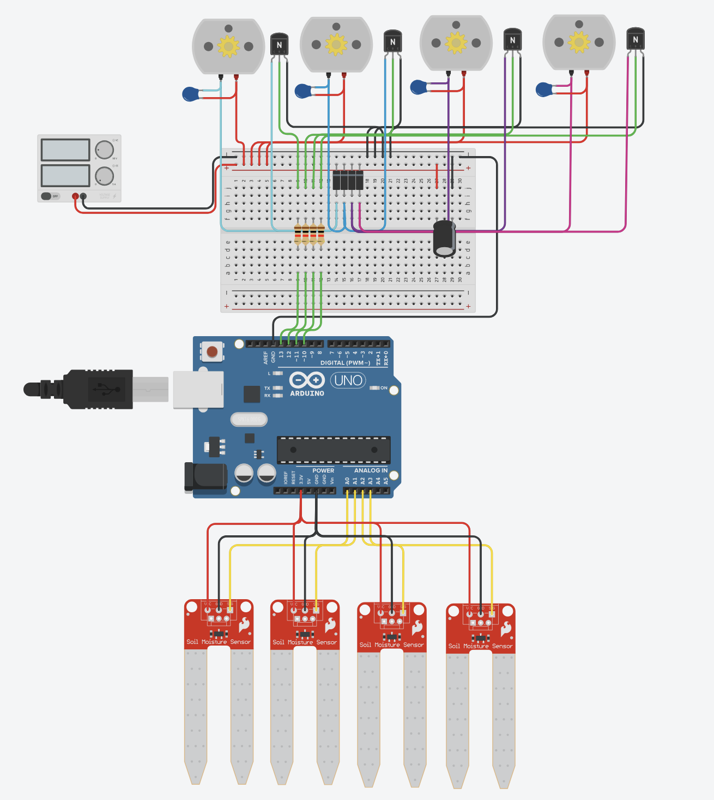

# Automated Multi-Channel Plant Irrigation System

An automated irrigation system built around the Arduino platform that independently monitors soil moisture across multiple plants and activates dedicated water pumps whenever moisture falls below configurable thresholds.

The project uses an array-based architecture to manage sensor readings and pump control through a shared loop, making it easy to configure existing channels and extend the system. Sensor power can be switched independently to reduce electrochemical corrosion, while dedicated transistor switching stages isolate the pumps from the Arduino's digital outputs.

## 🛠️ System Specifications

- **Microcontroller:** Arduino Uno R3
- **Logic and sensor supply:** 5 V DC
- **Pump supply:** Regulated 5 V DC external supply, sized for the combined pump current
- **Current implementation:** 4 independent irrigation channels
- **Sensor outputs:** Analog inputs A0–A3
- **Sensor power control:** Digital pins D4–D7
- **Pump control:** Digital pins D13, D12, D11, and D10
- **Calibration:** Configurable dry and wet reference values
  - Dry baseline: `0` (provisional)
  - Wet baseline: `539` (provisional)

> **Scalability:** The software uses arrays and loops to simplify channel management. The number of channels supported by the hardware is limited by available GPIO and analog inputs, sensor power requirements, pump drivers, and the power supply. Expanding beyond the current configuration may require multiplexers, external I/O expanders, or additional controllers.

## 📊 Individual Plant Configurations

Each irrigation channel has its own sensor, pump, and configurable moisture threshold. The current four-channel configuration is:

| Channel | Sensor Signal | Sensor Power | Pump Control | Threshold |
|:--|:--|:--|:--|:--|
| Plant 1 | A0 | D4 | D13 | `< 30%` |
| Plant 2 | A1 | D5 | D12 | `< 45%` |
| Plant 3 | A2 | D6 | D11 | `< 45%` |
| Plant 4 | A3 | D7 | D10 | `< 60%` |

Thresholds are examples, not universal plant requirements. Adjust the `turn_on_thresholds` array and calibrate each sensor in its intended growing medium.

## ⚡ Bill of Materials (BOM)

Component quantities below correspond to the current four-channel build. Additional channels require additional sensors, pump drivers, protection components, and sufficient power capacity.

| Qty | Component | Purpose |
|:--|:--|:--|
| 1 | Arduino Uno R3 or compatible board | Main controller |
| 4 | Analog soil-moisture sensors | Measuring soil moisture |
| 4 | 5 V mini submersible DC pumps | Independent watering |
| 4 | Suitable NPN transistors or logic-level N-channel MOSFETs | Low-side pump switching |
| 4 | 1 kΩ resistors for NPN transistor bases | Limiting base current |
| 4 | 1N4007 flyback diodes, subject to current suitability | Suppressing inductive voltage spikes |
| 4 | 100 nF ceramic capacitors | Reducing high-frequency motor noise |
| 1 | 220 µF electrolytic capacitor or appropriately sized alternative | Stabilizing the pump supply rail |
| 1 | Regulated 5 V DC power supply, initially targeting at least 2 A | Powering the pumps |
| As needed | Breadboard or prototyping board, jumper wires, and tubing | Assembly and water delivery |

## 🔌 Circuit Blueprint & Schematics

The current schematic illustrates the four-channel implementation. Each channel uses an independently powered moisture sensor and a dedicated low-side pump switching stage with flyback protection.